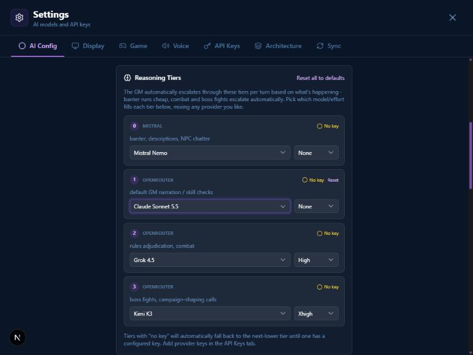
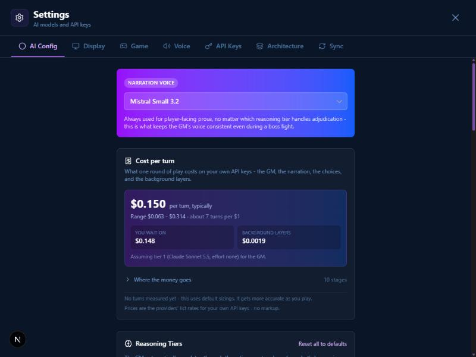
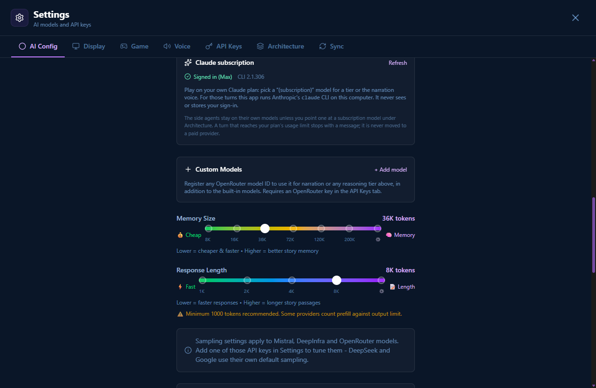
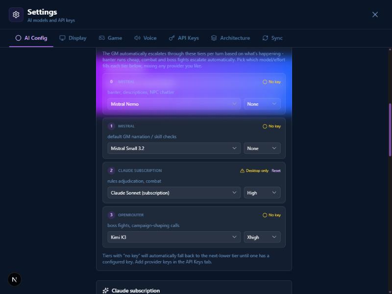
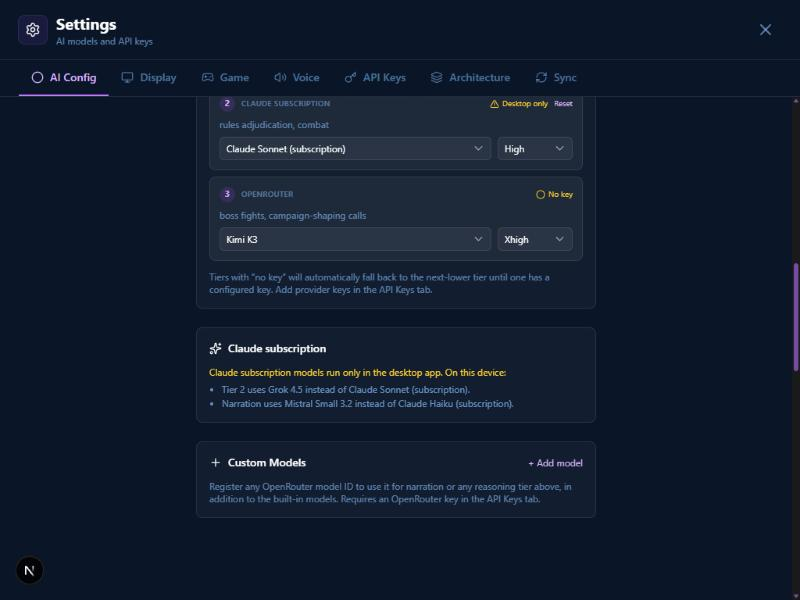
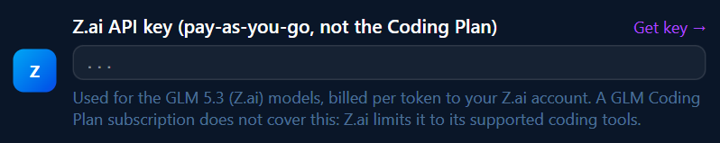
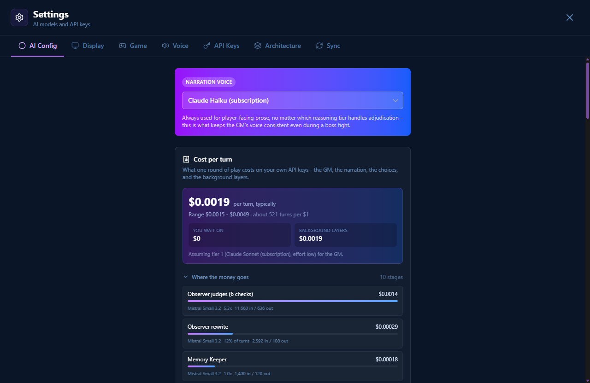
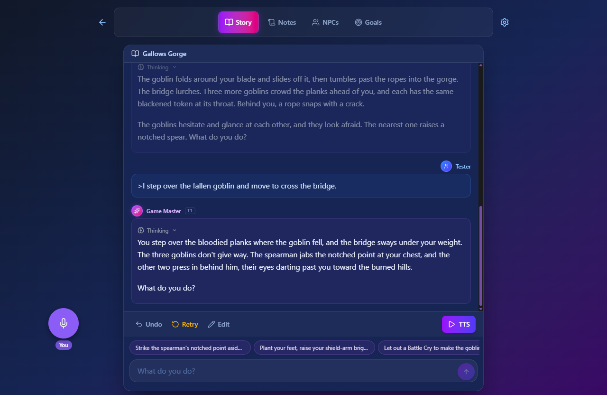

# 2026-10-21 — Claude and GLM as the game master

One session built three stacked PRs from `docs/claude-gm-implementation-plan.md`:

- **#205, Claude through OpenRouter** (Route A).
- **#206, GLM through Z.ai and OpenRouter** (the §7 addendum).
- **PR B, the player's own Claude subscription through the `claude` CLI** on the desktop app (Route B).

Most of the work is in the provider layer and the engine, and has no pixels. The screenshots below are the parts that reach a screen: from the browser preview, and from the built desktop app driven over WebView2's debugging port (`WEBVIEW2_ADDITIONAL_BROWSER_ARGUMENTS=--remote-debugging-port=9222`).

The first part of the session played no turn: every played turn spends the author's keys or plan, so those checks waited for the author's go. The only model calls were the two approved Haiku calls in B0. After the PRs merged the author said go, and the subscription route was played for real (see "The live run" below). The OpenRouter and Z.ai routes still wait: no key is saved in the app.

## Route A: Claude through OpenRouter

The three Claude 5.5 models appear in every picker under openrouter. "No key" shows because the preview has no OpenRouter key.

The pre-turn estimate prices Claude at list price ($0.150 a turn). This shot is what turned up the cost question:
- Claude only caches where a breakpoint is marked, so cached rounds bill at a tenth of the input price.
- The first commit priced every round at list. After the engine review, a Claude call is billed at OpenRouter's own `usage.cost`.
- The estimate above the tiers still reads high. That is a known follow-up.

What mattered most and has no screenshot:
- **Claude 5.5 rejects things every other provider is sent:** sampling parameters (even the base `temperature`), assistant prefill, forced `tool_choice`, and effort `none`.
- **It checks replayed thinking against edited history.** The GM's state message changes every turn, so thinking replay is scoped to the current turn.

## B0: two Haiku calls on the author's subscription

These ran from an empty scratch folder with a cleared environment:
- **`--safe-mode`** kept the claude.ai sign-in (`apiKeySource: "none"`) and dropped the author's own plugin; three built-in plugins stayed.
- **Structured output** comes back as `structured_output` on the final `result` event, through an internal `StructuredOutput` tool.
- **The CLI caches its prompt** with a one-hour TTL.

The full record is in the plan.

## Route B: the subscription through the CLI

This is the built `app.exe`, not the dev server. The Rust command ran `claude --version` and `claude auth status` with a cleared environment and returned `{"installed":true,"version":"2.1.306","loggedIn":true,"authMethod":"claude.ai","subscriptionType":"max"}`. That has no e-mail or organisation, which the command never reads out of the CLI's output.

The app was started from a shell full of `CLAUDE_*` and `ANTHROPIC_*` variables, and the status still showed the claude.ai sign-in. That is the cleared environment doing its job.

This is decision 16 on the web build, which cannot run the CLI. A tier and the narration voice were synced in from the desktop as "(subscription)" models:
- The tier reads "Desktop only".
- The new box lists what this device uses instead.

The keys were set by hand in the preview's own storage to simulate a sync, then removed.

The design changed in one place the plan did not foresee: the GM's stable history goes into the CLI's system-prompt file.
- **Why:** `claude -p` takes stdin as one text block, and the prompt cache can only match at block boundaries. A transcript that grows inside one block would never be read from the cache.
- **What it gives:** the system prompt is now identical in every round of a turn, and stdin only grows.

## PR C: GLM through Z.ai

The capture covers only the Z.ai block, because the rest of the tab holds the author's real (masked) keys.

In the same built app, the HTTP plugin's scope:
- **admits** `https://api.z.ai/api/paas/v4/chat/completions`;
- **refuses** `…/api/coding/paas/v4/…` and `…/api/anthropic/…` with "url not allowed on the configured scope".

That is decision 18's guardrail in the shipped allowlist, not just in a test.

OpenRouter's price for GLM depends on which host serves the call: GLM 5.2's 34 endpoints ran from $0.03 to $2.31 per M input. The catalog uses the model maker's own price, and the plan says why.

## The live run on the subscription

The cost panel reads $0 for the GM and tier lines, each with the new "on your subscription" badge.

This is a story played in the built desktop app, every tier on Claude Sonnet (subscription) and the narration voice on Haiku (subscription):
- **The story:** the GM named it "Gallows Gorge" itself.
- **The tier:** the "T1" badge on the GM's reply shows the tier that wrote it.
- **The chips:** the tappable choices under the prose were produced by the choices stage in stream mode, in 4.7 s and 6.6 s.

What the run showed (the numbers are in the plan, "First live run"):
- **A full GM turn** took 5 CLI rounds and 77 s (setup notes, `start_game`, two rolls, a tier switch from 3 to 1, then prose). Stop killed the CLI process within about a second.
- **Online play** posted its notice, showed four "Not used online" badges, and launched no CLI. After leaving the room everything came back.
- **The first round of a fresh conversation sometimes makes no tool call.** It happened once to the GM ("my dice and note tools aren't responding") and once to the Designer. Retry fixed both, and about 20 later rounds were fine. This is the one real finding, and it is written up with a proposed fix and nothing built.
- **The system prompt is about 108 KB**, 62% of it tool schemas.

The first attempt at all this talked to the wrong app. Two sessions had launched built apps on WebView2's debugging port 9222, so my driver clicked "Play Now" in another session's party-mode build and created a stray story there. I stopped, told that session, and relaunched in my own profile on port 9333 after checking who owned the port. The lesson is now in `CLAUDE.md`.

## What the reviews caught

Each PR went through the `engine-review` agent. The findings that changed code:

- **A Claude prefill drop that ate prose the player had read.**
  - The first version dropped any plain assistant message before a tool call.
  - A round the roll gate sends back is saved without the gate's re-prompt, so earlier turns hold exactly that shape.
- **Side agents' verdicts coming back empty without a warning.**
  - The cause: 200-token caps on models that always think.
  - The fix: a 4,096 floor for Claude and GLM-5.3.
- **The PDF importer** sending `temperature` to Claude.
- **#204's change** that would have put compaction on the CLI.
- **A Stop pressed in the first milliseconds of a CLI run** being lost.
- **`claude.cmd` installs** leaving `node.exe` running after Stop.
- **The subscription check** failing open on a renamed field.

Two calls belong to the author, not the review:
- **Online multiplayer** feeds guests' input into the host's CLI. Asked.
- **The cost ledger** prices non-Claude models at list. A follow-up.
