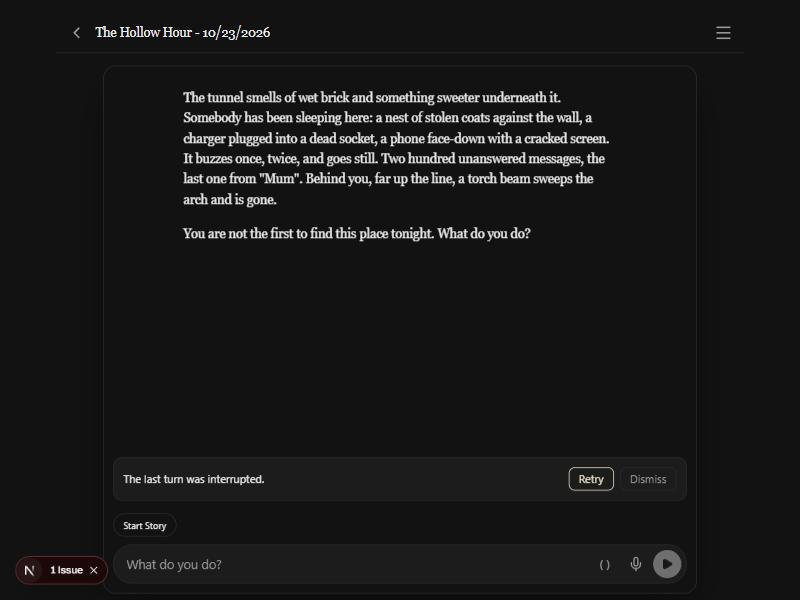

# 2026-10-23 — Android: turns that survive leaving the app, and the back gesture

Design: [`android-background-design.md`](../android-background-design.md).
Plan: [`android-background-plan.md`](../android-background-plan.md).
Decisions 132–136. Branch `claude/android-background`.

The author, on the phone: a turn died when they left the app, and the back
gesture closed the app. Five slices, all committed. Most of it is native, and
this machine has no Android SDK or phone, so it has no pixels to show. The
only screenshot is the interrupted-turn banner, from the browser preview.

## What is proven, and what is not

- **Proven here:** the JS side has tests (the suite and `tsc`). The engine
  review and the reading of the code found a few problems, fixed in the same
  branch.
- **Not proven here:** that a turn survives the screen going off, that the
  notifications appear, that the back gesture closes the right surface, and
  that the streaming and Stop work on a phone. Those are the checks in
  [`pending_tests.md`](../pending_tests.md) under 2026-10-23, and they are
  owed until the author runs the APK.

## The banner after a killed turn

This is a hand-written record, not a real kill. The story was reopened with
an interrupted-turn record in localStorage, and the story was cut back from
three parts to one. The banner "The last turn was interrupted." sits above the
composer with Retry and Dismiss. Dismiss was checked. Retry's wiring was read
but not clicked, because the preview browser may hold real provider keys and
a click would send a turn.

## Found on the way

- **The "GM is waiting for you" ping was missing.** The author found it while
  testing build 1: a question or a roll that paused the turn gave no
  notification while the app was in the background. It was added as
  `notifyPlayerNeeded`, posted only while the app is away.
- **The engine review found a live turn read as interrupted.** A reopen or a
  sync reload during a turn that was still running would cut its parts and
  offer a second Retry. Live turn ids are now tracked in the JS process, and a
  live turn is never read as interrupted. Back on the story during a live turn
  also now sends the app to the background, instead of going to the Library.
