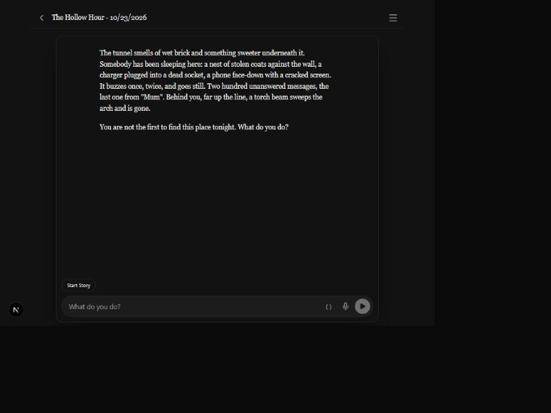
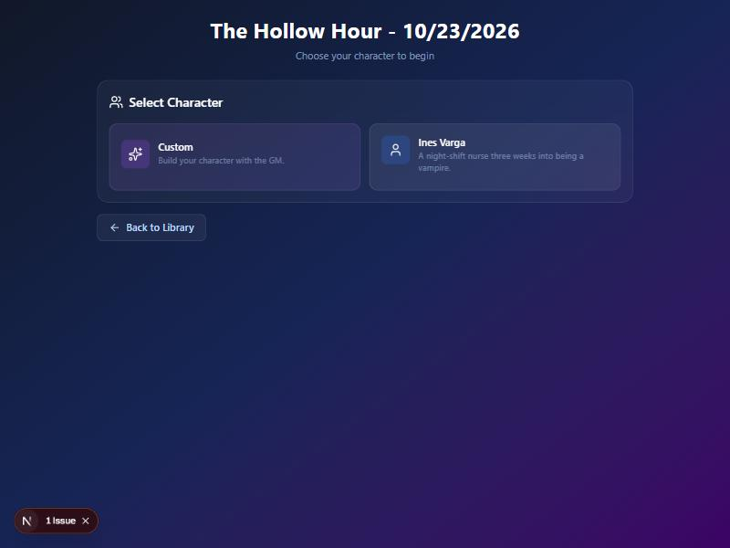
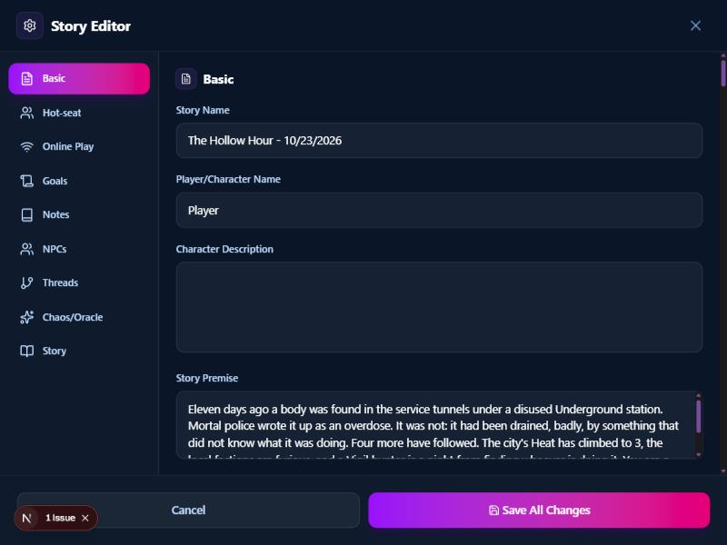

# 2026-10-23 — Removing the arcade leftovers

Design: [`legacy-removal-design.md`](../legacy-removal-design.md). Plan:
[`legacy-removal-plan.md`](../legacy-removal-plan.md). Decisions 125–131.
Screenshots are from the browser preview on the author's machine, in
[`2026-10-23-legacy-removal/`](2026-10-23-legacy-removal/).

## What started it

The author, starting *The Hollow Hour* (the built-in Blood & Bone adventure):
"it's still the deprecated menu." Two explorers read the code and could not
find attributes or inventory in the in-story menu. The preview found it in
the **character creation form**: a pattern list from the arcade days sorted
the sheet's fields by name, so Heart and Power landed under "Attributes",
Gear under "Equipment", and the other four stats plus fifteen more fields
under "Other". The template's own headings were ignored. Before it, a lone
"Custom" card advertised "Default Stats" and "Starter Items". That
reproduction, not the code reading, is what decision 125 rests on: the
explorers had been looking in the wrong place.

## Slice 1 — starting a story

Play → Start Without Notes now lands here: the intro, the composer, no
picker and no form. The saved story has `sessionZeroActive: true` and
carries the template, and while session zero lasts the GM sees the sheet
template in the live block. The template block itself shows up only on a
GM call, so the shot above proves the start and not the prompt. A unit test
covers the prompt, and a real session-zero run is on `pending_tests.md`.

For this shot I gave the same story one pre-made character and emptied its
turns. The picker comes back, without badges, and Custom reads "Build your
character with the GM." Picking Ines Varga writes her sheet as a note and
also starts session zero. That is the change Codex's review asked for: a
sheet with no Campaign Plan would otherwise never have been asked for
`start_game`.

## Slice 2 — the screens

Abilities, Variables and Relationships are gone from the Story Editor. The
note editor kept its trigger words and lost the variable checkboxes. A text
search for "Relationships" on the page did still hit, and it turned out to
be prose inside a Blood & Bone note, not a leftover. The game-over screen,
New Game+, the cooldown toasts, the Brave key and nine components nothing
imported went too.

## Slices 3 and 4 — nothing to photograph

These two slices are engine and data. Neither changes a single pixel.

- **Slice 3** removed nineteen GM tools from all six places a tool lives,
  along with `take_rest`, the H8 stat check, `end_combat`'s resource bridge,
  `rpgSystems.ts`, the skill trees and the ability system: about 4,250
  lines. A new test holds the six places together. A call to a removed name
  gets "Unknown tool" and changes nothing. The engine review found two stale
  lines the model still reads (timer text, a memory instruction), and both
  were fixed.
- **Slice 4** removed the fields from `structs.ts`, so `tsc` found the
  readers that were left. The proof is a save, not a screenshot. The old
  "Inventory Crash Repro" story was given a stat, an item, a variable, a
  variable trigger, a New Game+ count, a rest state and an arcade choice.
  It opened without an error, and after Save, IndexedDB held none of those
  keys. The choice came back as `{ "text": "Climb the wall" }`. The first
  check looked like a failure: every old key was still there. It turned
  out the scripted click had missed the Save row, so no save had happened.
  A second, real save showed the strip working.
- `tauri build` passed and the built app launched to its home page, on its
  own WebView2 profile and debugging port. That check was for the allowlist
  change, the Brave host leaving it.

## Numbers

- Tests went from 178 files / 2,727 to 172 / 2,537. The drop is deleted
  tests of deleted code (rpgSystems, advantage stacking, the sub-agent,
  reaction checks, price haggling, `add_memory`, H8, the stat and resource
  commands, the unused fuzzy matchers), with 30 new cases added (13 for the story start, 8 for the tool drift and
  the unknown-tool path, 9 for the strip).
- Lint is lower in every file touched, for example `menu.tsx` 71 → 47 and
  `page.tsx` 34 → 29.

## Not done here

- No real model ran, so whether GLM 5.3 actually fills the Blood & Bone
  sheet well is a `pending_tests.md` check for the author's go.
- On the way, a debug APK went out. The phone refused it ("App not
  installed") because the installed copy carried a different signing key.
  The CI now signs every debug APK with one key held as a repository secret
  (#229). Moving to that key cost one uninstall, and with it the phone's
  stored keys.
