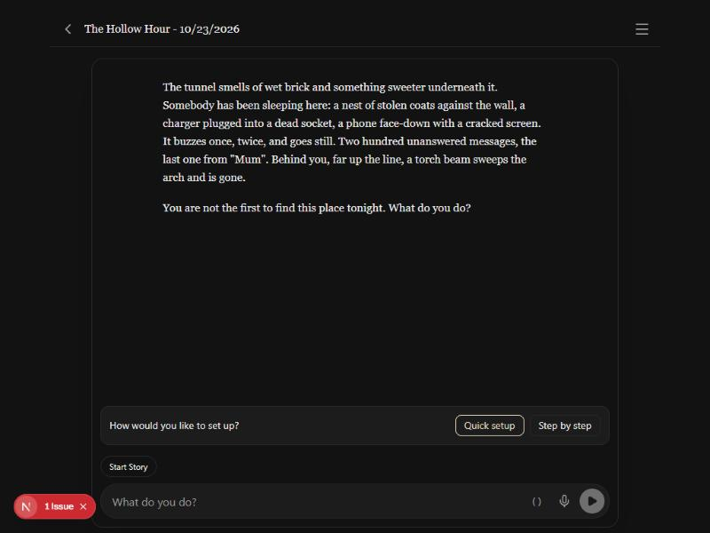
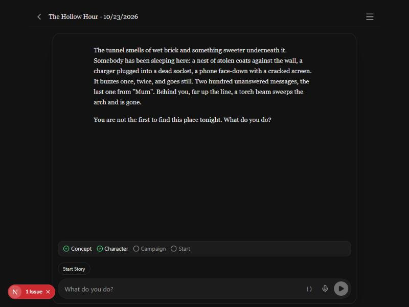

# 2026-10-23 — Campaign setup that actually sets up

Design: [`session-zero-design.md`](../session-zero-design.md). Plan:
[`session-zero-plan.md`](../session-zero-plan.md). Decisions 142–147. Branch
`claude/session-zero`. Screenshots are from the browser preview on the
author's machine, in [`2026-10-23-session-zero/`](2026-10-23-session-zero/).

## What started it

The author started a freeform Blood & Bone story, "I want to play as a
vampire", and exported the GM's context. In the export the GM did well at
first: it read the creation rules and asked three good questions as choices.
Then it never set the story up. It wrote no character sheet, no plan, and
never called `start_game`. It went straight into a scene with no character
and no reason to be there. The player wrote: "Okay, this is a horrible
campaign start, like I need a proper campaign intro." The GM answered "I'll
build your vampire properly first", and then did the same thing again.

The export is the evidence for the design. Nothing in the engine made setup
happen: the setup advice was prompt text, and `start_game` checked only for a
plan. Design §1 has the full reading.

## What the two screenshots show

*The Hollow Hour* story, put back into session zero by hand, so the strip
shows the start of the new flow: "How would you like to set up?" with
**Quick setup** and **Step by step**. Nothing has been chosen yet, so the
checklist is not there. A tap on either sets the mode and sends the player's
line.

The same story with a mode set, so the strip shows the four steps, and the
style buttons are gone:
**Concept** and **Character** are ticked, and **Campaign** and **Start** are
open. Character is ticked because the story already has a character sheet.
Concept is ticked for the same reason: a pre-made character or an old save
counts as having its concept, so no question is needed. Campaign is open
because there is no `gm_plan` note yet.

## What the screenshots do not show

The setup gate, the setup card and the multi-select question modal have no
screenshot. The gate and the card only run during a GM turn, and a GM turn
spends the author's key. These are the first checks in
[`pending_tests.md`](../pending_tests.md) (2026-10-23, Session zero), waiting
for the author's go. The multi-select modal is not on screen for the same
reason. Its checkboxes are unverified.

## The engine review

The engine review of slices 1–4 found two real bugs, and both are fixed:

- **Concept never ticked.** Concept required `setup.mode`, but nothing wrote
  `mode`. It now follows `conceptDone` or an existing sheet, as §3.1 says and
  as the tests check. `mode` now only shapes the strip and the prompt.
- **Retry narrated.** A session-zero Retry on the no-snapshot path passed the
  precomputed results, which skipped the setup gate and went straight to the
  narration call. It now runs the full GM loop. A guard in `generation.ts`
  also skips narration in that path if no `start_game` succeeded.

Codex's review found eleven problems, all checked against the code. The
main ones were that the gate failed open, the approval was not bound to the
text the card showed, Stop could be undone by the batch that resumed after
it, and streamed prose could not be taken back. Each is recorded, with its
fix, in the plan's "Codex's review (2026-10-23)" section. The fixes are
covered by tests in `tests/generation.setupGate.test.ts`,
`tests/setupProgress.test.ts` and `tests/gmTools.confirmSetup.test.ts`.

## Numbers

- Tests: the plan's baseline was 182 files and 2,802 tests. The session
  ended at 189 files and 2,933 tests, the figures the author gave for this
  branch.
- The Blood & Bone setup request, measured in slice 3, is 29,439 tokens
  against the 36,000 default GM-stage input budget. The tier pin that
  session zero uses costs more per turn, which is the author's call.

## Not done here

- No real model has run the flow. Whether GLM 5.3 or Claude asks the
  questions, writes the sheet and the plan, and then reaches the card is the
  first check in `pending_tests.md`.
- The guest's "the host is reviewing the setup" line was skipped. The only
  guest signal is the turn's generating state, which would need a protocol
  change.
- The strip and the modals have no DOM test setup. Only their pure parts are
  tested.
