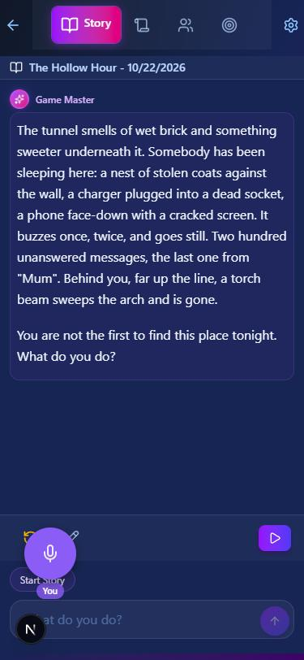
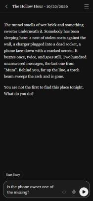
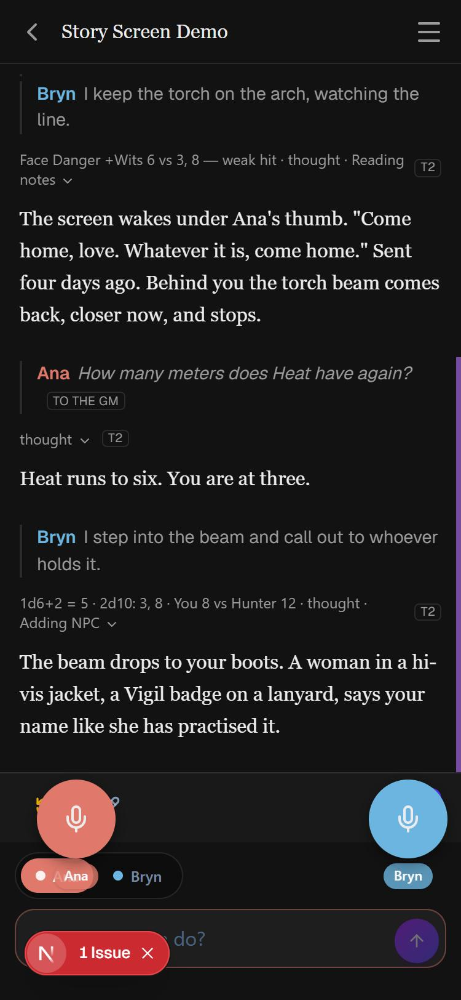

# Devlog — the story screen, simplified (2026-10-23)

The author showed two screenshots of OOC, another AI story app, and said "I
like how simple OOC is." This session took that from an interview (decisions
112–115) through a design (`docs/story-screen-design.md`, approved as decision
116), an implementation plan reviewed by Codex (`docs/story-screen-plan.md`,
decision 117), and seven slices on `claude/story-screen`. Every slice was
built by a Sonnet implementer from the plan, then looked at in the browser
preview before the next one started. The screenshots below are in
`2026-10-23-story-screen/`, numbered in the order they were taken.

Nothing here called a model. Hollow Hour has a single GM turn, so most shots
use a demo save written into the preview's IndexedDB by hand: "Story Screen
Demo", a copy of Hollow Hour with two couch players, an action roll, a roll
behind the GM's screen, a two-pool formula roll, an opposed roll, an
out-of-character question, a canvas-drawn test picture and, for one shot, a
fight.

## Before

At 375 px: a tab bar, a title strip, a purple "Game Master" card, an action
bar, the composer with a purple send, and a 64 px floating mic bubble that
sits on top of Undo/Edit and the "Start Story" chip. `02-before-desktop.jpg`
is the same at 1280 px.

## After

Solo play, Ink: one header row, the prose as a plain page in Georgia, and one
input bar with `( )` (talk to the GM), 🎙 and a white ▶.

Couch co-op: each speaker's line in their colour, the out-of-character
question in italics tagged "TO THE GM", and the GM's working folded into one
quiet line per turn ("Face Danger +Wits 6 vs 3, 8 — weak hit · thought ·
Reading notes"). The roll behind the GM's screen leaves no trace, folded or
open (`12`). Paper White (`22`), the menu sheet (`06`, `07` on Paper White),
the desktop panel (`09`) and the desktop column (`25`) show the rest.

## What the screenshots caught that the tests did not

The suite and `tsc` were green after every slice. Each of these was found by
looking:

- **Grey prose on a stale stylesheet** (`03`). After slice 1 the prose was
  dark grey on dark blue. Two causes: Turbopack was serving a cached
  `globals.css` with none of the new `--ys-*` tokens (clearing `.next/dev` and
  `.next/cache` fixed it; touching the file did not), and slice 1 had dropped
  the prose's inline colour, so the typography plugin's own grey for `prose`
  paragraphs won. Prose now sets `color: var(--ys-text)` inline (`04`).
- **Voice bubbles over the full-screen picture** (`14`). The story card's
  `backdrop-blur-xl` made it a stacking context, so the picture view's
  `z-[1000]` only counted inside the card. The card is solid now, so the blur
  went, and the view is portalled to `<body>` (`15`). This predates the
  redesign.
- **The actions row under a bubble** (`16`). The couch bubbles float over the
  bottom of the feed; the feed now gets room while they show, and they step
  aside while a turn is being edited (`18`).
- **The latest passage flashing on every tap** (`17`). Each re-render remounted
  the prose and replayed its fade-in: `prettify` builds react-markdown's
  components inline, the timeline was keyed by counter ids that change when a
  saved timeline is rebuilt, and `story.tsx` rebuilt each part's tool-result
  map every render. A DOM-identity check proved it (the `
` before and after
  a tap was a different node). Fixed with a memoized `ProseBlock`, position
  keys and memoized per-part data. This also predates the redesign; tapping a
  turn just made it visible.
- **The long out-of-character placeholder** (`20`) wrapped inside a one-line
  box at 375 px and showed a scrollbar; it is "Talk to the GM…" now.
- **A lone "…"** above a turn with no work line; the turn-actions toggle there
  is now hidden until it has keyboard focus (touch opens the row by tapping).
- **The die** (⚄) the design put before a roll was missing.

## Checked by hand in the preview

- ☰ opens the sheet with focus on Notes; it scrolls on its own; Escape closes
  it and focus returns to ☰; Notes opens under "‹ Notes ☰" on its old
  backdrop (`08`) and ‹ comes back; the Story Editor opens full screen from
  the desktop panel; Restart's confirm dialog sits above the sheet (`23`).
- Tapping the latest turn shows Retry, Edit and Read aloud; an earlier turn
  shows Edit only; an outside tap closes the row; Edit on a turn already in
  the summary says the GM reads the summary instead (`18`).
- The OOC toggle lights the bar and changes the placeholder; the input grows
  to two lines; ▶ brightens when there is text. Nothing was sent.
- The picture runs edge to edge (`13`), and its full-screen view has the cost,
  the model and Regenerate (`15`).
- Paper White: header, sheet, composer, combat strip and confirm dialog all
  readable.

## Not checked, and why

The slim read-aloud player and the mic in the bar need real audio and a TTS
or STT call on the author's key; the Android font, keyboard and microphone
permission need a phone. They are in `docs/pending_tests.md` under
2026-10-23.

## Left for the author

- The combat strip (`24`) keeps its old open-by-default layout and red
  colouring. Open, it takes about a quarter of a phone screen; the design
  called it slim. Collapsing it by default is a one-line change if wanted.
- The couch bubbles' default spot still overlaps the speaker switcher's name
  tag (`22`), as it did before (`01`). The bubbles can be dragged.
