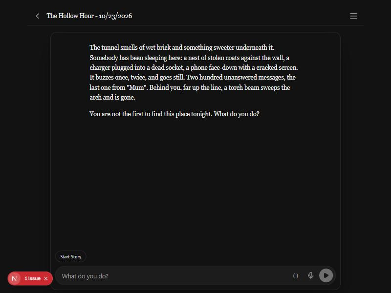
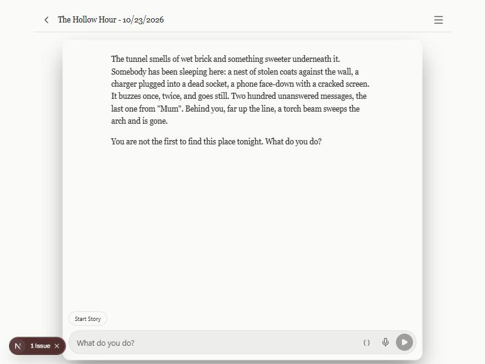

# Devlog — the reading themes reach the whole app (2026-10-23)

The author noticed the theme did not change the scrollbars, and asked for the
themes to reach the whole platform, with Ink as the default. The design is
`docs/whole-app-themes-design.md` (decision 141 approved it), the plan is
`docs/whole-app-themes-plan.md`, and the work is on `claude/whole-app-themes`
in six slices (the sixth is docs). Each slice was checked in the browser
preview, in Ink and in Paper White, with screenshots in
`2026-10-23-whole-app-themes/`, numbered in the order they were taken.

Nothing here ran on a phone or in the native apps. The shots are from the
browser preview, so the Next.js dev badge ("1 Issue", bottom left) is in most
of them.

## Before and after

The story screen in Ink, after the foundation slice. It is the Ink baseline
the plan asked for; the before-and-after comparison by eye is not in this
folder.

The same story in Paper White. The page background now follows the theme
(before, it followed the OS).

## What each slice showed

- **Slice 1, the foundation.** `03` is the half-way point: the Story Editor's
  shell is light, but its content is still dark-only. The labels and inputs
  are close to invisible on the light panel. The editor's content was
  converted in slice 3, which `07` shows.
- **Slice 2, Settings.** `04` (AI Config, Paper White) and `06` (API Keys,
  Paper White) read. `05` is the Display tab in Ink, with the nine theme
  swatches. Each swatch takes its colours from its own preset, so every theme
  shows what it looks like.
- **Slice 3, the story's sub-pages.** `07` (Story Editor), `08` (Notes) and
  `09` (AI Context) in Paper White. In the AI Context the layers keep their
  roles: the danger layer is a red tint, the rest are surfaces with accent
  headings.
- **Slice 4, Library and Designer.** `10` (Library in Paper White) has the
  gradient behind the header and the built-in pack in a warning tint. `11` is
  the Designer with a draft open, in Ink.
- **Slice 5, everything else and the party page.** `12` is the home page in
  Paper White, where the gradient is faint. `13` is the phone page in Sepia,
  with the Theme picker open and Sepia selected. The capture tiled the same
  phone frame four times into one image; the four panels are one screen, not
  four themes.

## What went wrong on the way

- **The scrollbars.** The author saw purple scrollbars on Paper White, and
  the old rules switched by OS dark mode. Decision 141 moved them into slice 1.
- **The script tag.** The pre-paint theme script was first rendered as a
  plain `<script>` in the root layout, and React warned about it on the
  client. `app/components/InlineScript.tsx` wraps it, with
  `suppressHydrationWarning`, so the script runs before paint and the warning
  goes.
- **A missed component.** Slice 4's `DraggableScroll` was missed, and a
  screenshot found it still dark. It is converted and on the ratchet now.

## Not seen yet

The desktop app, the Android APK and the party page on a real phone over the
LAN have not been checked. They are in `docs/pending_tests.md` under
"2026-10-23 — Whole-app themes".
