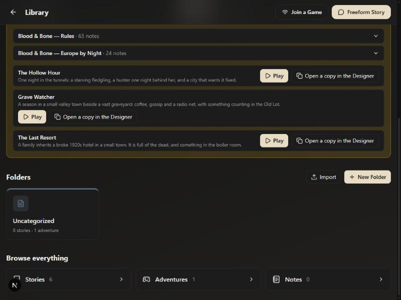
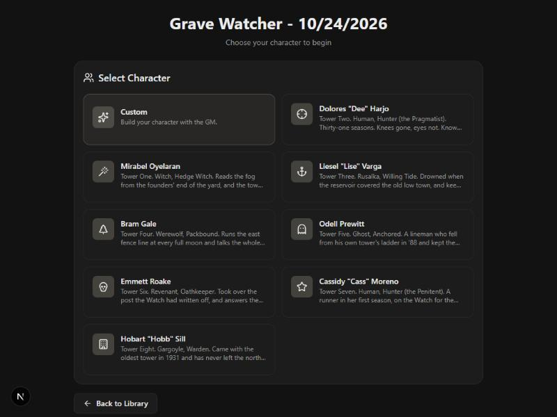
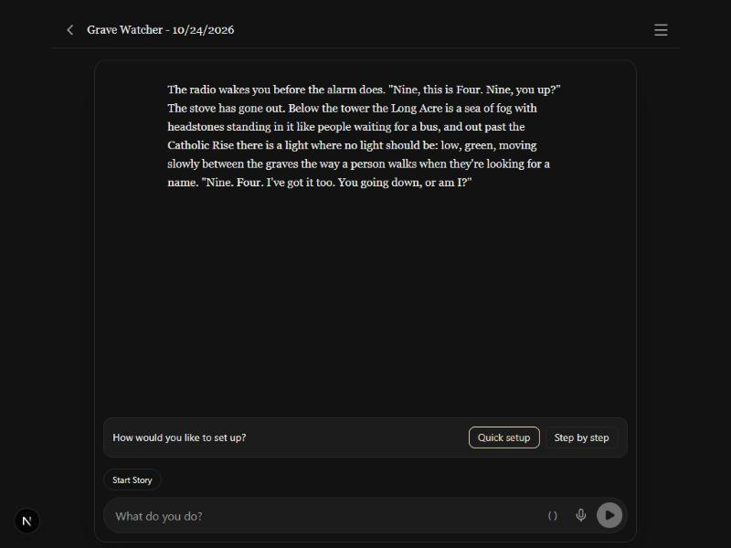
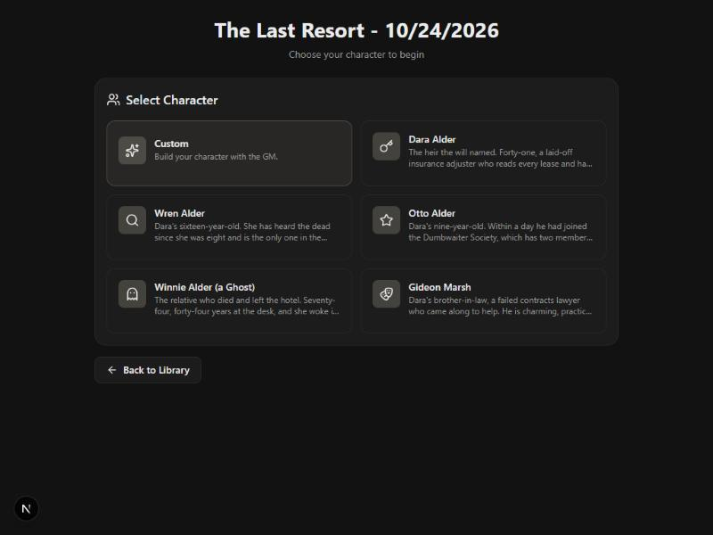
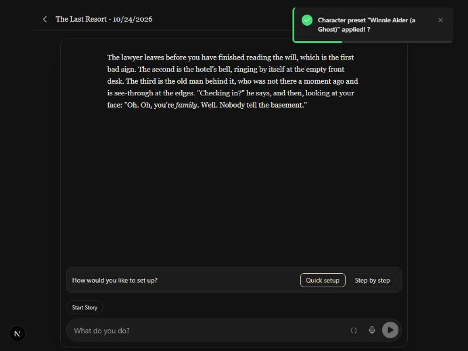

# 2026-10-24 — Blood & Bone E5: Grave Watcher and The Last Resort

Two campaign starters in their own worlds (`docs/bb-starters-design.md`,
decisions 163–173). Most of this session was interview and writing; one
small engine change, and the rest is content. Screenshots are from the
browser preview on the author's machine.

## How the design moved

- The author asked for "an adventure similar to haunted hotel" and
  "Grave Watcher", a world where the supernatural is normal and Watchers keep
  fire-lookout-style towers over huge graveyards. Two rounds of questions
  settled the rules (Blood & Bone, Masquerade off), the roster (any Kind), the
  hotel (inspired by the Netflix show's premise only, comedy-horror, the
  family as players) and the shape (both campaigns, both in America).
- The first draft read Grave Watcher as B&B's usual night-horror. The
  author's note, "more slice of life, life sim, gilmore girls vibe", turned it
  around: the town is the show, the Watch is the job, most nights are quiet
  and the radio is mostly gossip (decision 171).
- Then "Add 9 regulars and 35 occasional visitors. And 100 types of people":
  three layers of townsfolk, so the GM never invents a face from nothing
  (decision 172).

## What was built

The Library home lists both under Blood & Bone:

Play on Grave Watcher shows the roster, eight Watchers of eight Kinds, each
with a tower:

Picking Dee Harjo opens on the approved intro, with session zero's style
buttons. The saved story had `systemState.setting: "grave-watch"`, 76 notes
(the Rules mechanics plus the starter's own, no Europe by Night note), 25
NPCs, Unrest at 1, and Dee's sheet as its character sheet; a reload added
nothing (the 63 Rules ids were seeded as offered, so the twelve E1 tables
the starter leaves out never arrive):

The Last Resort's family, and its opening with Winnie (the relative who died)
picked:

(The toast's trailing "?" is the existing preset toast, not this change.)

## What has no pixels

- The setting field and the push rule (`builtinNotes.ts`): a test, not a
  screen. A Grave Watcher story is not given a new Europe by Night note; it is
  given a new Rules note; a Hollow Hour story still gets both.
- Whether the GM actually runs it slice-of-life, rolls the town tables and
  makes Taint with `manage_meter create`: that needs a real model, and is in
  `docs/pending_tests.md`.
