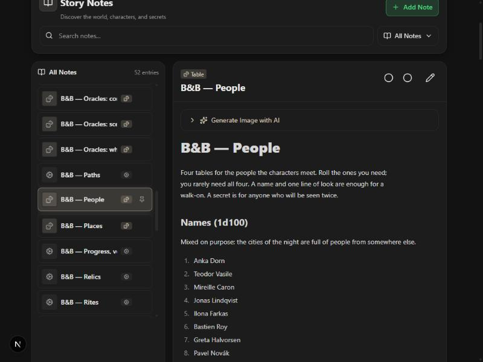

# 2026-10-24 — Blood & Bone, expanded: the tables (E1)

Design: [`bb-expansion-design.md`](../bb-expansion-design.md); samples:
[`bb-expansion-samples.md`](../bb-expansion-samples.md). Decisions 150–159.
Branch `claude/bb-expansion`.

## What happened

The author asked to "expand blood and bones by a lot". The interview set the
scope at three times the system's size, tables first, Europe deeper before
anywhere else, Claude writing and the author reviewing, and a sample of
each kind of material first. The samples (the People tables, Budapest, a
Vampire Archetype called the Courtier) were approved as written.

E1 is twelve table families (about 17,300 tokens, each note under the
2,500-token read cap) plus the three old oracles grown from d10 to d20, and
the engine work a pack three times bigger needs: a compact note list in the
GM's live block, new built-in notes reaching old stories when they open,
and a starter that carries only its own city. The tables were written by
three writers in parallel from one brief, then read through and edited.

## What the engine review caught

The review found the bug that mattered most: the tables named their dice
as `(d66)` and `(d20)`, and `formula_roll` reads a bare `d66` as the number
66 and `1d66` as a 66-sided die, so the GM would have landed on the last
entry every time or on a number with no entry. The headings now say exactly
what to pass, the parser reads `d20` as `1d20` and refuses d66 with a line
telling the GM to roll two d6 as tens and ones. A first fix refused every
unreadable character in a formula, which would also have refused the labels
GMs write ("1d6 + 2 (Nerve)"); that was caught in a probe and narrowed to
arithmetic only.

It also caught on-load adding firing for any story with one borrowed
Blood & Bone note, which would have slipped the core rules into someone
else's adventure. It now needs the core note and system tools not off.

## The screenshot

A *Hollow Hour* story made the day before, opened in the browser preview:
its Notes page lists 52 entries, the twelve new families among them, and
"B&B — People" open with its names table. Nothing else in the story moved.

## Not shown

Everything a GM does with the tables needs a real model and the author's
key: those checks are in [`pending_tests.md`](../pending_tests.md) under
2026-10-24.
