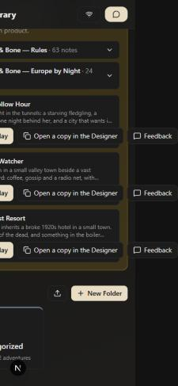
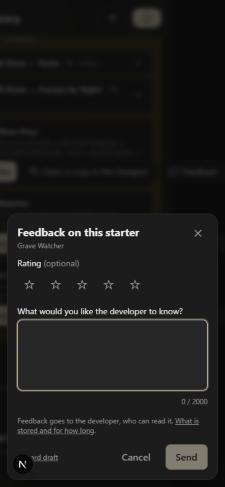
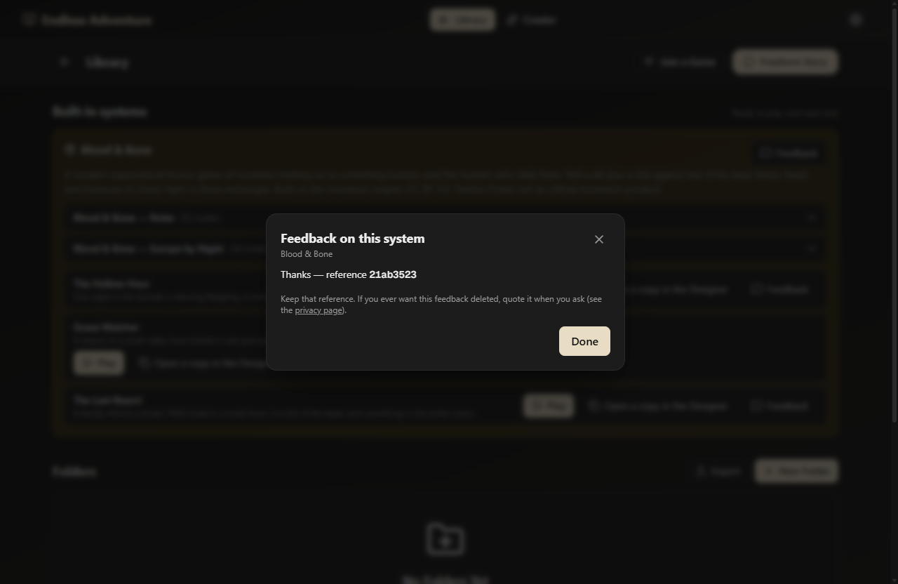

# 2026-10-24 — Feedback in the app

Decisions 190–194, `docs/feedback-design.md`. Two Sonnet implementers built it
in parallel: one on the Worker (`sync-worker/`: `POST /feedback` into D1, the
admin page, retention), one on the app (the form, five entry points, the
after-a-night card, the privacy page, build plumbing). This session reviewed
both, wrote the test that holds their two schemas together, and ran the whole
path for real: `wrangler dev` with a local D1, the web preview at phone width,
and a debug desktop build.

## What the checks caught

- **The two schemas disagreed.** `tests/feedback.schemaAgreement.test.ts`
  runs 38 cases through the app's `validateSubmission` and the Worker's
  `parseSubmission`. On its first run, one case failed: the app refused a
  `session` number on a kind other than `session`, and the Worker accepted it.
  The app now matches the Worker; the builder still never sends the number
  on another kind.
- **The Library scrolled sideways on a phone.** The added Feedback button
  made each starter's button row (Play, Open a copy in the Designer,
  Feedback) wider than the screen. The page measured 465 px on a 375 px
  screen. The row now wraps.

## The path, end to end

- **Library → a starter's Feedback → 4 stars and text → Send.** The form shows
  "Thanks — reference 7abd9f67", and the row is in the local D1 with the
  system, the starter, the rating, the version and the platform, and no IP
  column. `<b>` typed into the text shows as literal text on the admin page.
- **A story turn → Feedback → Attach this turn.** The preview holds the
  player's line, the prose, two one-line roll summaries and the model, and
  nothing else: the turn's `add_npc` result and an earlier turn's hidden
  `gm_roll` are absent. The stored `turn_json` matches the preview.
- **After a night.** The card appeared only once the test story was switched
  from couch co-op to solo (the demo story is couch co-op, where the card is
  meant to stay hidden). Showing it wrote the marker "offered", and Dismiss
  stayed dismissed through a reload.
- **The story menu → Send feedback.** It closes the menu and opens the form.
  Settings → Game has the switch and the button.
- **Offline.** With the Worker stopped, Send said "Couldn't reach the
  feedback server…", kept the draft and offered Try again. Discard draft
  cleared it.
- **The debug desktop build** (`tauri build --debug --config
  src-tauri/tauri.dev.conf.json`) sent through the Tauri HTTP plugin to the
  local Worker, which stored it with platform `desktop`.

## Not seen

The real D1, the secret and the deploy are the author's. A real rate-limit
refusal and the cron firing were not seen either. Neither was a send from
Android or iOS. All are in `docs/pending_tests.md`.
