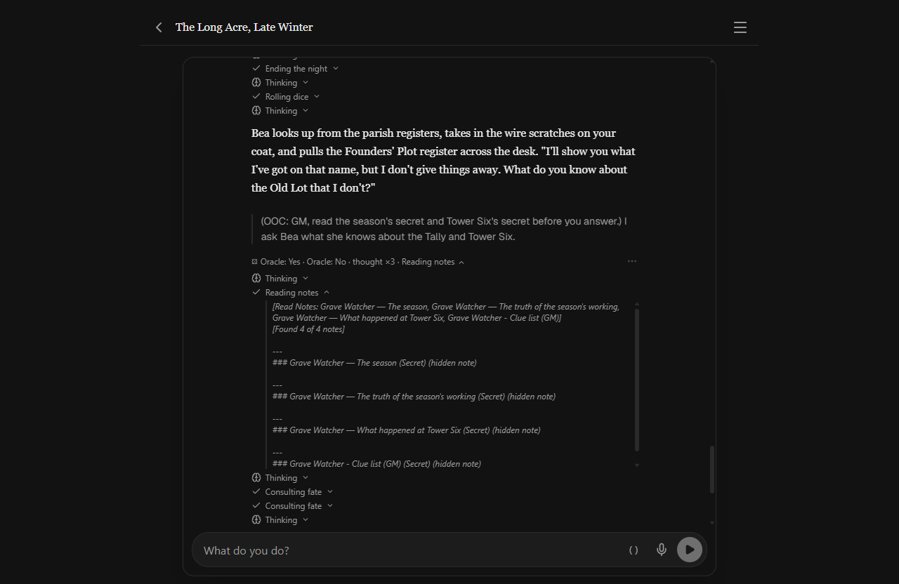

# 2026-10-24 — The judge layer: flag only

After decision 185, Codex reviewed the whole judge layer
(`docs/research/codex-judge-layer-review-2026-10-24.md`) and found rewrites
replacing text the player had read, races, double mechanics and misfed
judges. The author chose flag-only defaults (decision 187); the design is
`docs/judge-layer-design.md`.

On the desktop build, a Grave Watcher turn where the GM read four secret
notes: no judge call and no rewrite ran (the new defaults), and the work
line's "Reading notes" shows each secret's title with "(hidden note)", none
of its text:

Settings → Architecture (browser preview): every judge reads Off / Flag (and
"Rewrite automatically" for the three prose judges); Outcome/Narration
Mismatch is on Flag, the other five Off.

Not seen live: a reversed roll producing the outcome flag, a Save-as jump
during a background wave (the engine-review fix for a late result landing
on the wrong story), Stop during a judge. They are in
`docs/pending_tests.md`.
