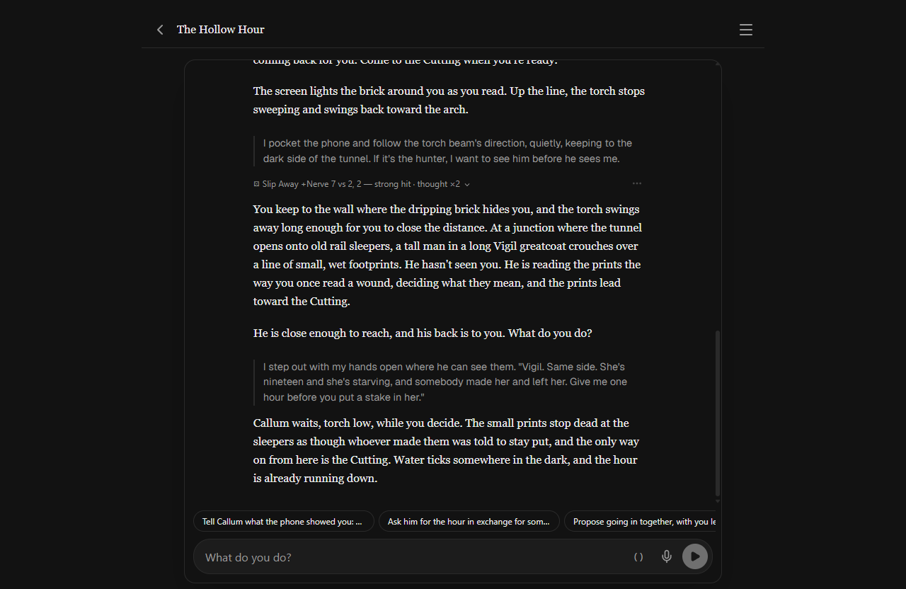

# 2026-10-24 — Playtest of the three Blood & Bone starters, reviewed with Codex

Three sessions on the desktop app built from master (after #241 and #242), on
the player's Claude subscription: Claude Haiku (high) for ordinary turns,
Claude Sonnet for session zero and plan calls. A small driver typed the
player's lines, answered setup questions by rotation and pressed "Start the
story" on the setup card. Codex (gpt-6.1-sol, high) then read all three
transcripts beside the rules, the starters and the engine (decision 178).

## The sessions

- **Grave Watcher**, Dee Harjo, quick setup: two setup questions; the GM
  created Dee's Taint meter exactly as the Running-it note says; read the two
  season secrets; wrote a campaign plan over the town calendar. Then a night
  call down to the Catholic Rise (a weak hit to read a stone, a missed Slip
  Away and a miss-table price), and a morning at the Lamplight where the GM
  rolled "Who's at the Lamplight" and the gossip table, and Walt, Pearl and
  Marisol played their running bits. The town worked.
- **The Last Resort**, Winnie Alder (the ghost aunt), quick setup: one Sonnet
  round claimed every call had failed with "No such tool available" and the
  setup stalled until the player typed "continue". After that: Mr. Pell, the
  will, the bookings table, Hester.
- **The Hollow Hour**, a Hunter built in session zero: the fixed setup order
  (#242) ran cleanly through the setup card, the People names table was
  rolled, Callum was met and talked down with a strong Compel.

The last turn in that shot is Codex's finding 2: a strong Compel (with a
match) bought the hour, the GM recorded it (Callum went to neutral, the plan
advanced), and the prose the player read never shows Callum agreeing.

## What Codex and the playtest found, and what was fixed

| | Problem | Fix |
|---|---|---|
| 1 | A mid-setup round claimed its tools were down ("No such tool available") and stalled session zero | The CLI retry now applies to any round; later rounds count only the CLI's error wording or an OOC aside, so story prose about tools is never thrown away (engine review) |
| 2 | A strong hit not shown in the prose | GM prompt: show every roll's outcome |
| 3 | Dawn crossed with no end_session or Reckoning | Core: dawn is named ("they sleep, next morning…"). **Not fixed by the wording: the replay still skipped it** (below) |
| 4 | A miss against the green light gave no Taint | Grave Watcher: any miss about a working, whatever the miss table says |
| 5 | The Hollow Hour's setup card showed Runa's hidden history and the four endings | Session-zero prompt: the plan is shown on the card; truths and endings go in a secret note |
| 6 | The GM dodged "whose name is it?" twice | GM prompt: answer what the player asks |
| 7 | The match line said "a complication on a hit", against the core | `matchNote`: a matched strong hit goes memorably right; a matched miss doubles the price |
| 8 | A rolled miss-table entry swapped for another | Core: keep the rolled entry, else Stress +1 |
| 9 | Slip Away used to approach and scout | Core: pick the move from what they want |
| 10 | Repeated staging, "(Nothing has been rolled yet)", "the fourteenth line" | GM prompt: no bookkeeping in the story |
| 11 | Timers reported "(auto)" though nothing ticks them | New timers are manual; the live block always says to advance them by hand |

## The replay

The fixed build, the same Grave Watcher story:

- **The name.** In character ("I tell them the name I read") the GM still said
  "the name from the stone". Asked in OOC brackets, it named Corwin Voss at
  once. Better, not solved: the in-fiction ask still slides past.
- **Dawn.** "At dawn I climb down and go to bed. Next morning, I go find Cora"
  produced no `end_session` and no Reckoning. The rule is in the pinned core;
  Haiku does not act on it. This needs the engine, not more wording: a
  reminder in the live block when the player's line crosses dawn, or the
  setup of a new day. Left open.
- Not replayed: Taint on a miss (needs the dice to miss near the light), the
  strong-hit narration (needs a strong hit), the tool stall (intermittent).
