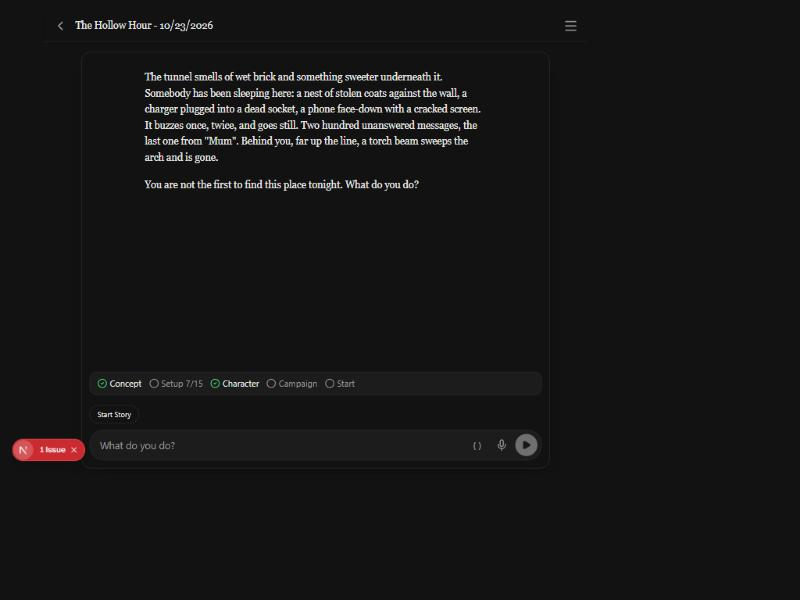

# 2026-10-24 — A step-by-step setup that is actually step by step

Design and plan: [`session-zero-detail-design.md`](../session-zero-detail-design.md).
Decisions 148 and 149. Branch `claude/session-zero-detail`. The screenshot is
from the browser preview on the author's machine.

## What started it

The author played the first real step-by-step setup on the APK and said it
was "way too short". Their context export showed the GM asking seven
questions and inventing the rest: the name, connections, burdens, the whole
background, the tone and the campaign. The export also caught two bugs: an
empty last round re-showed the first step's line, and after **Start the
story** the GM called nothing, so the player had to type "Let's go".

## The plan went through two reviews before any code

Codex (gpt-6.1-sol) read the plan and found ten problems; nine were folded
in (design §6). The ones that mattered: auto-start would never have reached
the turn loop's "the game started" flag, "show only the latest words" would
have erased the intro's own prose, and one couch player's answer would have
covered a step for everyone. The tenth, online guests receiving the whole
story (§6.12), is an existing bug left for its own PR.

The engine review of the built slice found two more: quick setup threw away
a setting-and-tone question asked as one, and hitting the 10-round tool limit
(a full build is 15 steps) re-showed a question already answered. Both are
fixed, as is a test that passed with the feature broken.

## What the screenshot shows

A copy of a *Hollow Hour* story, seeded by hand in full mode with the world
steps and four character steps covered: the strip reads **Setup 7/15**
between Concept and Character. 15 is the solo Blood & Bone count: three world
steps, nine system steps, three about who the character is. Character is
ticked because the story already holds a sheet; the card still stays shut
until the count is full.

## What it does not show

Everything else here runs only inside a GM turn, which spends the author's
key: the questions with their intros, the card refusing, Start starting, the
gate's lines. The question modal's intro and its scrolling have no
screenshot for the same reason. They are the 2026-10-24 entries in
[`pending_tests.md`](../pending_tests.md). Most of this session was engine
work, checked by scripted GM rounds in Vitest (3,000 tests).
