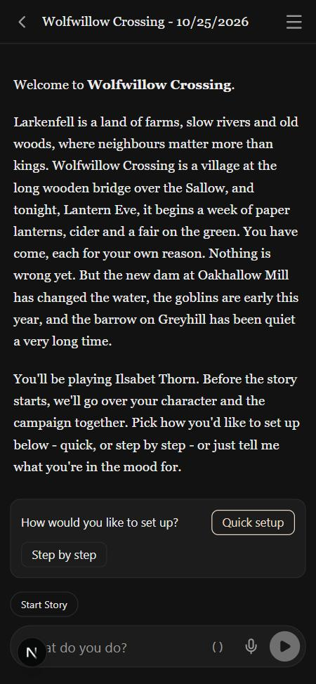
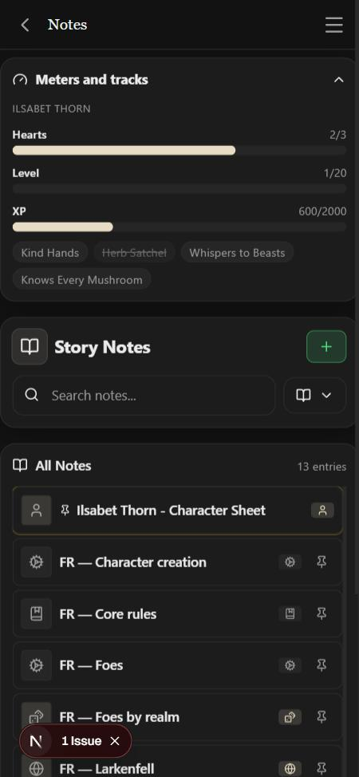

# 2026-10-25 — Fantastic Realms

The second built-in system, from the author's rules to a registered system in
one day: an interview (decisions 201–211), a design, a second round of
questions (212–215), Codex's review and three more answers (216–218), "Build
it" (219), then two Sonnet implementers in parallel, the engine in this
checkout and the content in its own worktree, merged here.

## What the session looked like

Mostly engine and prose, so mostly not visual. Slices 1–2 are plumbing and
arithmetic: systems declare their tools, a story records its system, five new
GM tools, and a meter whose maximum can grow. None of that renders except the
feat chips. Slices 3–5 are notes the GM reads. The only screens are the
Library row, the welcome and the Meters panel.

## What the checks caught

- **Codex found twelve problems in the design**, none of them a re-decision:
  "hit" meaning both a die and a result, a foe's initiative with no meaning
  when foes never roll, meters that could not grow, an outcome judge that names
  `action_roll` in three places, a note loader hard-wired to Blood & Bone. The
  design was rewritten before any code (its §9 maps each one).
- **The browser caught a realm that would never arrive.** The content worker
  copied only Larkenfell into the starter and expected the loader to add the
  other two realms. The Notes page showed thirteen notes and no Aurelane or
  Gloamreach: a starter's story is seeded as already offered every note it
  would be given, so the loader skips them. The starter now copies the whole
  world pack, and a test holds it.
- **Registering the real system broke four tests** that had pushed a stand-in
  with the same id behind it; the stand-in now takes the real one's slot for
  the run.

## The screens

The welcome for *Wolfwillow Crossing*, with a pre-made hero (decision 197's
welcome, then setup, then the Lantern Eve arrival).

The Meters panel with a hero's state written by hand (no model was run):
Hearts 2/3, Level 1, XP 600/2000, and the four feats as chips, *Herb Satchel*
burned.

## Not seen

A played turn: the GM setting up a hero, a `feat_roll`, a burn, an XP award,
a rest. That needs a model and the author's key; it is in
`docs/pending_tests.md`.
